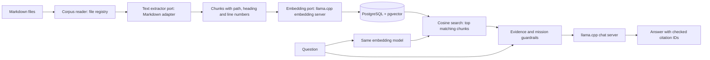

# How the RAG works

The application has two separate paths. **Indexing** prepares searchable evidence when the Markdown corpus changes. **Answering** uses that index for each question. Neither path trains or fine-tunes a model.

## Indexing

`python -m small_rag.cli migrate` applies versioned SQL migrations. `python -m small_rag.cli index` then walks the configured corpus, extracts Markdown text, divides it into bounded chunks, asks the embedding server for one 1024-number vector per chunk, and stores vectors plus source metadata. The active index generation changes only after the complete rebuild succeeds. A failed rebuild leaves the previous generation available. These are operator commands; API startup and chat requests never index files.

The application depends on two input ports: a corpus reader enumerates documents, and a text extractor converts one source file into extracted text. The file reader dispatches by registered extension; this release registers only `.md` and `.markdown` with the Markdown adapter. To add PDF later, implement a PDF extractor and register `.pdf` in the outer composition layer. The indexing use case, chunker and database port remain unchanged. A new extractor or a changed registration changes the index recipe, so rebuild the index before querying. No adapter for other formats is shipped or implied.

An embedding model maps a text passage to a vector learned during its pretraining and retrieval training. Texts with similar meaning should land near one another in that vector space. The embedding model does **not** answer the question. The same embedding model and indexing recipe must be used for stored chunks and incoming questions; changing them requires a rebuild. Its quality is statistical, so a nearby vector is a candidate passage, not proof that a fact is true.

## Answering

`POST /v1/chat` embeds the question, asks pgvector for the nearest chunks, filters weak matches, and sends bounded evidence to the chat model. In PostgreSQL, `<=>` is pgvector's cosine **distance** operator: smaller means closer. The application converts it to a similarity score for its threshold. The chat model receives the mission from `prompts/system.md` and the voice from `prompts/SOUL.md`. It must emit citation IDs from the retrieved evidence. The application checks those IDs and returns relative Markdown paths and line ranges. When no acceptable evidence remains, it asks the model to phrase a short refusal in the question's language while enforcing the `insufficient_context` status and empty citations. An invalid refusal produces an API error. An invalid answered citation triggers one additional refusal generation attempt.

These guardrails limit the answer path but cannot guarantee factual correctness. In particular, a valid citation ID proves that a retrieved chunk was supplied, not that every sentence is supported by that chunk. Calibrate the similarity threshold and review real answers with representative French questions before exposing the service widely.

## Components and boundaries

`llama.cpp` is a C/C++ inference project and executable suite, not one source file. Its `llama-server` executable loads local GGUF weights and exposes HTTP endpoints. This stack runs separate server containers for embeddings and chat so each model can stay loaded. FastAPI owns the HTTP application; PostgreSQL stores the index; Caddy terminates HTTPS, authenticates callers and proxies requests to FastAPI. Only Caddy has public host ports in the domain profile. See [deployment.md](deployment.md) for the exact network and operating steps.

The `ChunkWriter` and `ChunkSearcher` ports separate the indexing and answering needs. The PostgreSQL adapter implements both. The `Generator` port describes the exact two-prompt call used by the answering use case. FastAPI and the CLI construct concrete adapters at the outer boundary.

The `/v1` prefix reserves room for future incompatible API contracts while keeping the current request and response shape stable. “Retrieval” is the question-time search between question embedding and answer generation. It does not refer to downloading the model or ingesting documents.
